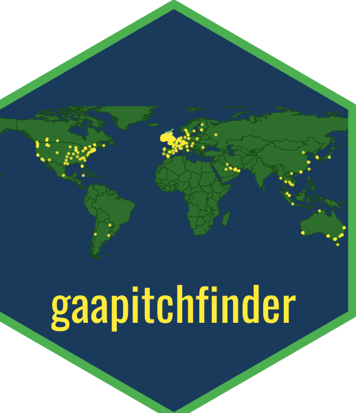

# gaapitchfinder 

<!-- badges: start -->
<!-- badges: end -->

The **gaapitchfinder** R package provides GAA (Gaelic Athletic Association) pitch location data and geospatial analysis tools for Ireland. The package enables R users, sports analysts, GAA researchers, journalists, local authorities, county boards, and GIS practitioners to easily answer questions about GAA pitch locations, density, and accessibility.

## Features

- **Built-in Dataset**: 1,990+ GAA pitch locations with coordinates, club information, and geographic metadata
- **Search Functions**: Find pitches by name, club, or county
- **Spatial Analysis**: Find nearest pitches and pitches within a radius
- **Summary Statistics**: County-level pitch counts and distribution
- **Visualization**: Plot pitch locations on maps using ggplot2
- **Offline Functionality**: Works entirely offline after installation
- **Tidyverse Compatible**: Follows tidyverse conventions and works with pipes

## Installation

You can install the development version of gaapitches from GitHub:

``` r
# install.packages("devtools")
devtools::install_github("yourusername/gaapitchfinder")
```

## Quick Start

``` r
library(gaapitchfinder)

# Access the built-in dataset
data("gaa_pitches")
head(gaa_pitches)

# Search for pitches
croke_park <- find_pitch("Croke Park")

# Find nearest pitch to coordinates (Dublin city center)
nearest <- nearest_pitch(lat = 53.3498, lon = -6.2603, n = 3)

# Find pitches within 10km radius
nearby <- pitches_within_radius(lat = 53.3498, lon = -6.2603, radius = 10)

# Get county summary
summary <- county_summary()

# Visualize pitches
plot_pitches(gaa_pitches)
```

## Data Source

The pitch location data is sourced from the [GAA Pitch Finder](https://gaapitchfinder.com) project by Ryan McGuinness. The dataset is licensed under Creative Commons Attribution 4.0 International License (CC BY 4.0).

## License

The package code is licensed under the MIT License. The dataset is licensed under CC BY 4.0.

## Citation

If you use this package in your research or analysis, please cite:

```
McGuinness, R. (2026). gaapitchfinder: GAA Pitch Location Data and Geospatial Analysis Tools.
R package version 0.1.0. https://gaapitchfinder.com
```
